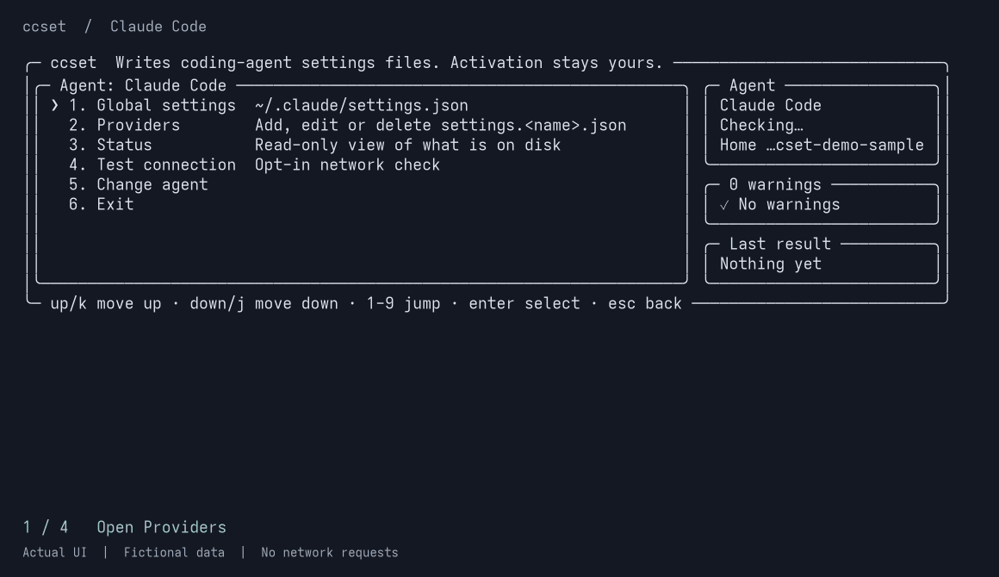

# ccset

Configure and select API providers for Claude Code, opencode, Codex CLI, pi, and Grok Build from a terminal. Edits preserve custom configuration; no daemon or local proxy.

```bash
npx @droite/ccset
```

[简体中文](README.zh-CN.md) · [Documentation](https://right202209.github.io/ccset/)

## Demo



[View the animation](https://github.com/Right202209/ccset/blob/master/docs/media/ccset-demo.gif). Captured from the actual UI with fictional settings in an isolated temporary directory; no personal configuration or live API requests.

## Quick Start

Requires **Node.js 18+**.

1. Choose a language on first launch. The TUI lists locally detected Agents and enters a sole match automatically.
2. Open **Providers → Add a provider**, enter the fields, and press **Ctrl+S**.
3. Select the saved Provider using the Agent's activation step below.

For an undetected Agent, use `npx @droite/ccset --agent claude-code`. Arrow keys move, **Enter** selects, and **Esc** returns.

A preset supplies public starting values and asks for a hidden key in a terminal:

```bash
npx @droite/ccset claude-code add relay --preset openrouter
npx @droite/ccset claude-code run relay
```

List presets with `npx @droite/ccset presets list`. Saving and activation are separate; existing sessions keep their configuration.

| Agent | Selector | Activation |
| --- | --- | --- |
| Claude Code | `claude-code` | `use <id>` prints `claude --settings …`; `run <id>` starts that session |
| opencode | `opencode` | `use <id>` saves Provider/model for next start |
| Codex CLI | `codex` | `use <id>` switches routing and saved auth for next start |
| pi | `pi` | `use <id>` saves default Provider/model for next start |
| Grok Build | `grok-build` | `use <id>` saves default model for new sessions |

To install the command globally: `npm install -g @droite/ccset`. The prepared unscoped forwarding package has separate release status; use the scoped install above.

## Scripts

```bash
ccset claude-code status --json
ccset opencode global set --model example/model --dry-run
```

Scripts name the Agent positionally, with `--agent`, or through `CCSET_AGENT`. `set` patches supplied fields; `--unset` removes a field. Status is read-only; dry-run creates no writes or backups. Supply keys through a secret store's **`CCSET_TOKEN`** or explicit **`--token-stdin`**, never argv.

The [CLI guide](docs/user-guide.md#cli) and [command contract](docs/milestone-3-non-interactive.md) cover options, JSON, refusals, and exit codes.

## File safety

- Managed edits preserve unmanaged keys at every depth; TOML/JSONC retain unrelated comments and formatting.
- Configuration replacement/deletion backs up existing targets and uses per-file atomic writes, with POSIX `0600`. Malformed replacement requires an explicit choice.
- TUI secret fields are masked; managed credential fields are omitted from command output. **Files and backups may contain plaintext credentials.** Up to ten backups per file remain until **Status → Clear ccset backups**.
- Provider deletion/ignore are confirmed TUI actions. Deletion removes the whole named file/block; ignoring changes only ccset's list preference.

Editing is local. Claude Code's optional Test connection confirms the host, refuses redirects, and discards response bodies; `run` starts Claude Code, which makes its own requests. Per-file atomicity does not protect concurrent writers. [Current safety follow-ups](review.md) and [the user guide](docs/user-guide.md#what-it-will-not-do-to-your-files) document limits.

## Project guides

macOS/Linux are supported; WSL and Windows Terminal/PowerShell are best effort; `cmd.exe` is unsupported. Windows ACLs are not managed. Only the latest npm release is supported.

[User guide](docs/user-guide.md) · [Support](SUPPORT.md) · [Security](SECURITY.md) · [Contributing](CONTRIBUTING.md) · [Verification](docs/verification.md) · [Adding an Agent](docs/adding-an-agent.md) · [MIT](LICENSE)
