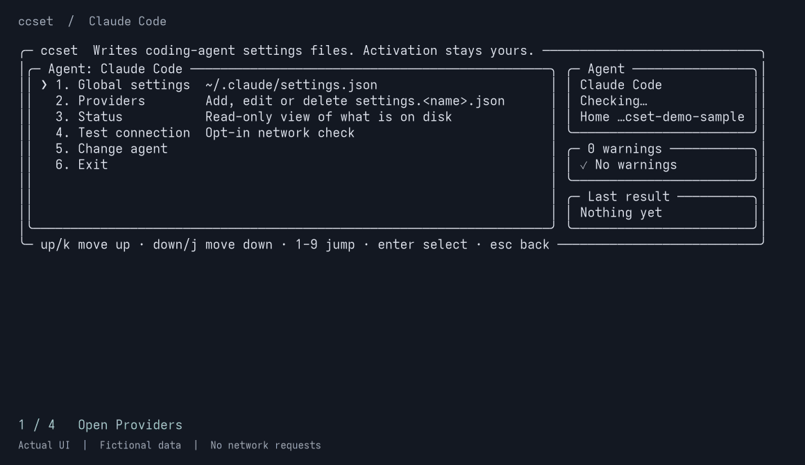

# ccset

Switch API providers for your coding agents from any terminal. No desktop app or local proxy. Keep your custom settings.

```bash
npx @droite/ccset
```

[简体中文](https://github.com/Right202209/ccset/blob/master/README.zh-CN.md) · English · [Documentation](https://right202209.github.io/ccset/)

## Demo



[View the animation](https://github.com/Right202209/ccset/blob/master/docs/media/ccset-demo.gif). Captured from the actual UI with fictional settings in an isolated temporary directory; no personal configuration or live API requests.

## Quick Start

Requires **Node.js 18+**. The command above opens the interactive interface for Claude Code, Codex CLI, opencode, pi, and Grok Build.

1. Choose English or Simplified Chinese on first launch, then select an agent. Only locally detected agents appear; a sole match opens automatically.
2. Open **Providers → Add a provider** and enter your provider ID, API endpoint, and credential. Fields vary by agent.
3. Review the fields and press **Ctrl+S** to save. Follow the agent's activation step described below.

Use the arrow keys to move, **Enter** to select, and **Esc** to go back.

For first-time setup when an agent is not detected:

```bash
npx @droite/ccset --agent claude-code
```

To keep the `ccset` command installed:

```bash
npm install -g @droite/ccset
ccset
```

For a preset, choose your Agent and paste a key into the hidden prompt:

```bash
ccset claude-code add relay --preset openrouter
ccset claude-code run relay
```

`ccset presets list` lists the bundled presets; add a search term to filter them.
For another Agent, use `ccset <agent> use relay` after saving. `use` prints the
Claude Code session command; `run` starts it. Other Agents save a default for
their next start. An explicit selector wins over `CCSET_AGENT`; only an
interactive terminal can infer a sole detected Agent.

These short commands are for the next release. To try this checkout, run
`npm ci` and `npm run build`, then replace `ccset` with `node dist/cli.js`.

## Core features

- **Five agents, one interface.** Manage global settings and multiple providers; inspect local configuration with Status.
- **Keep your custom settings.** Edits preserve unmanaged keys at every nesting level. TOML and JSONC edits also preserve unrelated comments and formatting.
- **Back up before changing files.** Existing files are backed up, each file is written atomically, and writes use `0600` permissions on POSIX. Replacing malformed configuration requires an explicit choice.
- **Control provider lists.** Edit, ignore, or delete providers from the TUI. Ignoring only hides a provider in ccset; deletion removes its file or configuration block after a backup.
- **Use scripts and CI.** Explicit commands support JSON output and dry-run previews. `set` changes only supplied fields; `--unset` explicitly removes a field.
- **Work in English or Simplified Chinese.** The TUI remembers your choice and adapts to terminal width, with configuration summaries on wider terminals.

| Agent | `--agent` ID | After saving a provider |
| --- | --- | --- |
| Claude Code | `claude-code` | `ccset claude-code use <id>` prints a session command; `ccset claude-code run <id>` starts it. |
| opencode | `opencode` | `ccset opencode use <id>` saves the provider/model for the next start. |
| Codex CLI | `codex` | Choose the provider's **Use** action to switch routing and the saved credential together. Requires a Responses API endpoint. |
| pi | `pi` | Set the default provider and model in **Global settings**, or use the CLI's `use <id>`. |
| Grok Build | `grok-build` | Set the default model in **Global settings**, or use the CLI's `use <id>` for new sessions. |

See the [agent configuration guide](https://github.com/Right202209/ccset/blob/master/docs/user-guide.md#agent-configuration) for file locations, credential handling, and environment overrides.

## FAQ

### Will ccset upload my configuration or API key?

Configuration editing is local. `run` starts your installed Claude Code, which makes its own requests. Within ccset, only Claude Code's optional **Test connection** sends a provider request, after showing the destination host and asking for confirmation. Redirects are refused. Other agents do not offer this probe.

The TUI masks credentials, and command output omits them. **Configuration files and backups can contain plaintext credentials**; masking is not encryption. Backups keep up to ten copies per file under the agent's `backups/ccset/` directory. After rotating a key, remove old copies through **Status → Clear ccset backups**. See the [security policy](https://github.com/Right202209/ccset/blob/master/SECURITY.md) before sharing logs or reporting a problem.

### Will it overwrite settings I already have?

ccset re-reads files before saving and changes managed fields while preserving unmanaged siblings. Blank TUI fields remove their managed values; omitted command options preserve existing values. Explicit provider deletion removes the entire provider file or block, including its custom keys, after a backup. See the [file safety details](https://github.com/Right202209/ccset/blob/master/docs/user-guide.md#what-it-will-not-do-to-your-files).

### Can I use it in scripts or CI?

Yes. Name the Agent as a positional argument, with `--agent`, or through `CCSET_AGENT`:

```bash
ccset claude-code status --json
ccset opencode global set --model example/model --dry-run
```

`status` is read-only; `--dry-run` plans a change without writing files or creating backups. Supply secrets through **`CCSET_TOKEN`** from your secret store or **`--token-stdin`**, never command arguments. Interactive mode requires a TTY. The [CLI reference](https://github.com/Right202209/ccset/blob/master/docs/user-guide.md#cli) covers commands, options, and exit codes.

### Why did saving a provider not switch my agent to it?

Saving and selection remain separate. All five Agents accept `use <id>`; see the timing in the table above. Existing `--agent <id> provider use <id>` commands still work. Before Codex replaces an unsaved login, you must choose whether to save it as a profile or replace it; a backup is taken either way. See the [Codex guide](https://github.com/Right202209/ccset/blob/master/docs/user-guide.md#codex-cli) for credential and `CODEX_HOME` constraints.

### Which platforms are supported?

**macOS and Linux** are supported. **WSL and Windows Terminal with PowerShell** are best-effort; `cmd.exe` is unsupported. Only the latest npm release is supported. See the [support policy](https://github.com/Right202209/ccset/blob/master/SUPPORT.md) and [Windows limitations](https://github.com/Right202209/ccset/blob/master/docs/user-guide.md#windows).

### How can I contribute or add an agent?

Start with the [contribution guide](https://github.com/Right202209/ccset/blob/master/CONTRIBUTING.md), [verification guide](https://github.com/Right202209/ccset/blob/master/docs/verification.md), and [adding an agent](https://github.com/Right202209/ccset/blob/master/docs/adding-an-agent.md). ccset is released under the [MIT License](https://github.com/Right202209/ccset/blob/master/LICENSE).
