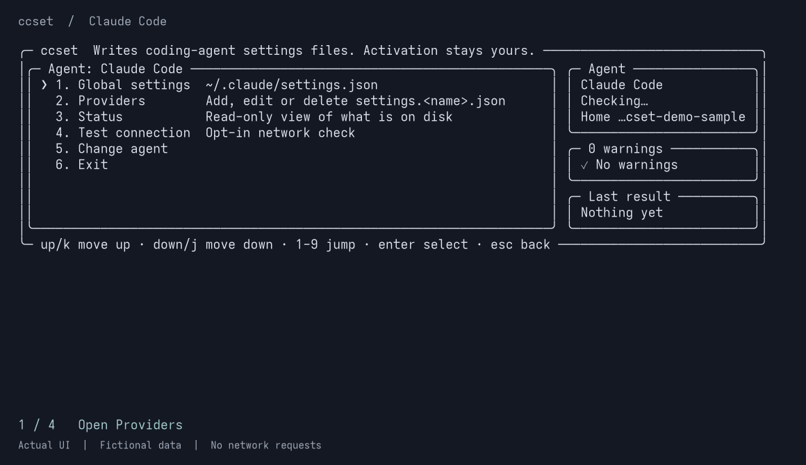

# ccset

在终端中配置、选择 Claude Code、opencode、Codex CLI、pi 和 Grok Build 的 API 提供商。编辑时保留自定义配置，不启动常驻服务或本地代理。

```bash
npx @droite/ccset
```

[English](README.md) · [文档网站](https://right202209.github.io/ccset/)

## 快速开始

需要 **Node.js 18+**。

1. 首次启动选择语言。TUI 只列出本地检测到的 Agent；只有一个时自动进入。
2. 进入**提供商 → 添加提供商**，填写字段，按 **Ctrl+S** 保存。
3. 按下表启用已保存的提供商。

尚未检测到 Agent 时，运行 `npx @droite/ccset --agent claude-code`。方向键移动，**Enter** 选择，**Esc** 返回。

预设提供公共初值；在交互终端中会提示输入隐藏的密钥：

```bash
npx @droite/ccset claude-code add relay --preset openrouter
npx @droite/ccset claude-code run relay
```

`npx @droite/ccset presets list` 列出预设。保存和启用是两个步骤，已有会话保持原配置。

| Agent | 选择器 | 启用方式 |
| --- | --- | --- |
| Claude Code | `claude-code` | `use <id>` 打印 `claude --settings …`；`run <id>` 启动该会话 |
| opencode | `opencode` | `use <id>` 保存提供商和模型，下次启动生效 |
| Codex CLI | `codex` | `use <id>` 切换路由与已保存凭据，下次启动生效 |
| pi | `pi` | `use <id>` 保存默认提供商和模型，下次启动生效 |
| Grok Build | `grok-build` | `use <id>` 保存默认模型，供新会话读取 |

全局安装命令：`npm install -g @droite/ccset`。仓库中的无作用域转发包独立发布；安装使用上方带作用域的包名。

## 脚本

```bash
ccset claude-code status --json
ccset opencode global set --model example/model --dry-run
```

脚本通过位置参数、`--agent` 或 `CCSET_AGENT` 指定 Agent。`set` 只改传入字段，`--unset` 删除指定字段。Status 只读，dry-run 不写文件、不创建备份。密钥只通过密钥存储注入的 **`CCSET_TOKEN`** 或显式 **`--token-stdin`** 传入，不放进命令参数。

选项、JSON、拒绝条件和退出码见 [CLI 指南](docs/zh-CN/user-guide.zh-CN.md#cli)与[命令契约](docs/zh-CN/milestone-3-non-interactive.zh-CN.md)。

## 文件与密钥安全

- 受管编辑保留各层级的非受管键；TOML/JSONC 还保留无关注释与格式。
- 配置替换、删除前备份已有目标，逐文件原子写入；POSIX 使用 `0600`。替换损坏文件需明确选择。
- TUI 密钥字段遮罩显示，命令输出省略受管凭据字段。**文件与备份可能包含明文密钥。** 每个文件最多十份备份，通过**状态 → 清除 ccset 备份**删除。
- 删除、忽略提供商是需确认的 TUI 操作。删除移除整个目标文件/块；忽略只修改 ccset 的列表偏好。

配置编辑在本地完成。Claude Code 的可选连接测试确认目标主机、拒绝重定向并丢弃响应体；`run` 启动 Claude Code，由它自行发请求。逐文件原子写入不保护并发写入。[安全待处理项](review.md)和[用户指南](docs/zh-CN/user-guide.zh-CN.md#不会对你的文件做的事)记录实际限制。

## 演示与项目指南



动图使用隔离 home 与虚构配置。[查看动图](docs/media/ccset-demo.gif)。

支持 macOS/Linux；WSL、Windows Terminal/PowerShell 为尽力支持；`cmd.exe` 不受支持。ccset 不管理 Windows ACL。只维护 npm 最新发布版。

[用户指南](docs/zh-CN/user-guide.zh-CN.md) · [支持](docs/zh-CN/SUPPORT.zh-CN.md) · [安全](docs/zh-CN/SECURITY.zh-CN.md) · [贡献](docs/zh-CN/CONTRIBUTING.zh-CN.md) · [验证](docs/zh-CN/verification.zh-CN.md) · [添加 Agent](docs/zh-CN/adding-an-agent.zh-CN.md) · [MIT](LICENSE)
