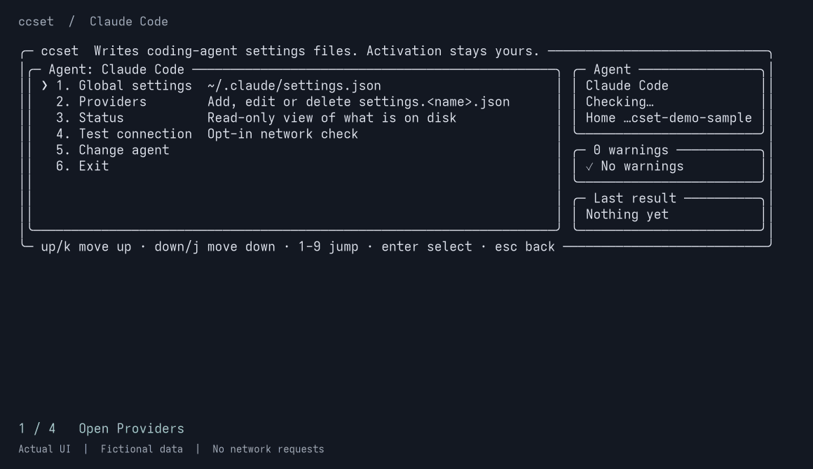

# ccset

在同一个终端界面或脚本化 CLI 中，为 **Claude Code、opencode、Codex CLI、pi 和 Grok Build** 配置第三方 API 提供商。

简体中文 · [English](https://github.com/Right202209/ccset/blob/master/README.md) · [文档网站](https://right202209.github.io/ccset/)

## 动图演示



[查看动图](https://github.com/Right202209/ccset/blob/master/docs/media/ccset-demo.gif)。使用隔离临时目录和虚构配置，从实际界面采集；不含个人配置，也未向真实 API 发送请求。

## 一键安装 / Quick Start

需要 **Node.js 18+**。无需全局安装，直接运行：

```bash
npx @droite/ccset
```

1. 首次启动时选择英文或简体中文，再选择 Agent。列表只显示本机检测到的 Agent；只有一个时会直接进入。
2. 进入**提供商 → 添加提供商**，填写提供商 ID、API 地址和凭据。具体字段因 Agent 而异。
3. 检查表单，按 **Ctrl+S** 保存，再按下表中对应 Agent 的方式启用。

方向键移动，**Enter** 选择，**Esc** 返回。

首次配置、尚未检测到 Agent 时，可以直接指定：

```bash
npx @droite/ccset --agent claude-code
```

如需安装为常用命令：

```bash
npm install -g @droite/ccset
ccset
```

## 核心特性

- **五种 Agent，一个界面。** 管理全局设置和多个提供商，通过状态页检查本地配置。
- **保留自定义设置。** 编辑时保留各层级中不受 ccset 管理的键；TOML 和 JSONC 编辑还会保留无关的注释与排版。
- **先备份，再写入。** 修改已有文件前先备份，逐文件原子写入，POSIX 系统使用 `0600` 权限；替换无法解析的配置需要明确确认。
- **管理提供商列表。** 在交互界面中编辑、忽略或删除提供商。忽略只在 ccset 中隐藏；删除则在备份后移除对应文件或配置块。
- **适合脚本与 CI。** 显式命令支持 JSON 输出和 dry-run 预览。`set` 只修改传入的字段，`--unset` 显式删除字段。
- **中英双语，适配终端宽度。** 界面记住语言选择，宽终端可同时显示配置摘要。

| Agent | `--agent` ID | 保存提供商后如何启用 |
| --- | --- | --- |
| Claude Code | `claude-code` | 运行 ccset 给出的 `claude --settings <path>` 命令。 |
| opencode | `opencode` | 启动 opencode，由它读取配置。 |
| Codex CLI | `codex` | 选择提供商的「使用」操作，同时切换路由和已保存的凭据；端点须支持 Responses API。 |
| pi | `pi` | 在「全局设置」中设置默认提供商和模型，或使用 CLI 的 `provider use <id>`。 |
| Grok Build | `grok-build` | 在「全局设置」中设置默认模型，或使用 CLI 的 `provider use <id>`，供新会话读取。 |

配置文件位置、凭据处理和环境变量覆盖规则见 [Agent 配置指南](https://github.com/Right202209/ccset/blob/master/docs/zh-CN/user-guide.zh-CN.md#agent-配置)。

## 常见问题

### 会上传我的配置或 API 密钥吗？

配置编辑在本地完成。只有 Claude Code 可选的「测试连接」会发送提供商请求，发送前会显示目标主机并要求确认，且拒绝重定向。其他 Agent 不提供此探测。

界面会遮罩凭据，命令输出不包含密钥。**配置文件和备份可能包含明文凭据**，遮罩不等于加密。备份位于对应 Agent 的 `backups/ccset/` 目录，每个文件最多保留十份。轮换密钥后，可通过**状态 → 清除 ccset 备份**移除旧副本。分享日志或报告问题前，请阅读[安全政策](https://github.com/Right202209/ccset/blob/master/docs/zh-CN/SECURITY.zh-CN.md)。

### 会覆盖我已有的设置吗？

ccset 保存前会重新读取文件，修改受管理字段并保留不受管理的同级键。TUI 中清空字段会删除对应的受管理值；命令中省略选项则保留已有值。显式删除提供商会在备份后移除整个提供商文件或配置块，包括其中的自定义键。详见[文件与密钥安全说明](https://github.com/Right202209/ccset/blob/master/docs/zh-CN/user-guide.zh-CN.md#不会对你的文件做的事)。

### 可以在脚本或 CI 中使用吗？

可以。安装后，使用带 `--agent` 的显式命令：

```bash
ccset --agent claude-code status --json
ccset --agent opencode global set --model example/model --dry-run
```

`status` 只读；`--dry-run` 仅生成变更计划，不写文件、不创建备份。密钥通过密钥存储注入 **`CCSET_TOKEN`**，或使用 **`--token-stdin`** 传入，不要放在命令参数中。交互模式需要 TTY。完整命令、选项和退出码见 [CLI 参考](https://github.com/Right202209/ccset/blob/master/docs/zh-CN/user-guide.zh-CN.md#cli)。

### 为什么保存后没有切换到新提供商？

保存与启用是两个步骤，请使用上表中对应 Agent 的操作。Codex、pi 和 Grok Build 也提供 CLI 命令 `provider use <id>`。Codex 替换尚未保存为档案的登录凭据前，需要你选择另存为档案或替换，两种情况都会先备份。凭据与 `CODEX_HOME` 的限制见 [Codex 指南](https://github.com/Right202209/ccset/blob/master/docs/zh-CN/user-guide.zh-CN.md#codex-cli)。

### 支持哪些平台？

支持 **macOS 和 Linux**。**WSL、Windows Terminal + PowerShell** 为尽力支持，`cmd.exe` 不受支持。仅维护 npm 上的最新版本。详见[支持政策](https://github.com/Right202209/ccset/blob/master/docs/zh-CN/SUPPORT.zh-CN.md)和 [Windows 限制](https://github.com/Right202209/ccset/blob/master/docs/zh-CN/user-guide.zh-CN.md#windows)。

### 如何贡献或添加 Agent？

请从[贡献指南](https://github.com/Right202209/ccset/blob/master/docs/zh-CN/CONTRIBUTING.zh-CN.md)、[验证指南](https://github.com/Right202209/ccset/blob/master/docs/zh-CN/verification.zh-CN.md)和[添加 Agent](https://github.com/Right202209/ccset/blob/master/docs/zh-CN/adding-an-agent.zh-CN.md)开始。项目采用 [MIT 许可证](https://github.com/Right202209/ccset/blob/master/LICENSE)。
