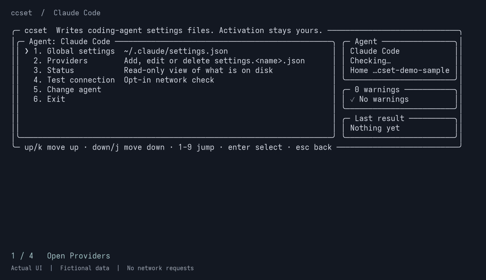

# ccset

> **存档说明。** 这是 2026-11-10 收到的产品评审快照，除本说明外原样保留。评审依据的是当时已推送的仓库和 v0.10.0，部分结论已被之后的提交改变；其中的竞品数据和下载量未经本项目独立核实，引用前请重新查证一手来源。维护者据此做出的决定见[项目计划](../zh-CN/project-plan.zh-CN.md)。

**给编程 Agent 换 API 提供商，只改你点名的那几个键。**

不装桌面应用，不起本地代理，不建自己的数据库。

支持 Claude Code、opencode、Codex CLI、pi 和 Grok Build，提供终端界面和可脚本化的 CLI。

简体中文 · [English](https://github.com/Right202209/ccset/blob/master/README.md) · [文档网站](https://right202209.github.io/ccset/)

```bash
npx @droite/ccset
```

需要 Node.js 18+，无需全局安装。



## 为什么是 ccset

- **没有第二份配置**。ccset 不维护自己的提供商数据库，每次都从 Agent 的配置文件里读。卸载它，一切照常。
- **只改点名的键**。其余的键原样保留；TOML 和 JSONC 文件连注释、空行和键顺序也不动。每次写入前先备份，逐文件原子写入。
- **做不到就拒绝**。比如 Codex 改用系统密钥链之后，ccset 会直接告诉你它无法切换，而不是写一个不会生效的文件。
- **先看再改**。写入类命令都支持 `--dry-run`。密钥只通过 `CCSET_TOKEN` 或 stdin 传入，不会出现在命令参数里。

## 和 CC Switch 怎么选

[CC Switch](https://github.com/farion1231/cc-switch) 是功能全面的桌面管理器。两者的取舍不同：

| | ccset | CC Switch |
| --- | --- | --- |
| 形态 | 终端（TUI + CLI） | 桌面应用 |
| 需要图形界面 | 否 | 是 |
| 提供商数据 | 只在各 Agent 自己的配置目录 | 自有数据库，切换时写入配置 |
| 本地代理、协议转换 | 无 | 有 |
| 提供商预设 | 无，手动填写 | 90+ |
| MCP、Skills、Prompts | 不管理 | 统一管理 |
| 支持的工具 | 5 | 12 |

**用 CC Switch**：你想要图形界面和预设，想在 Claude Code 里用非 Anthropic 协议的模型，或者想统一管理 MCP。

**用 ccset**：你在 SSH、容器或 CI 里工作，自己维护配置文件，或者不希望任何工具替你保存第二份配置。

## 三步开始

1. 首次启动时选择语言，再选择 Agent。列表只显示本机检测到的 Agent；只有一个时直接进入。
2. 进入**提供商 → 添加提供商**，填写提供商 ID、API 地址和凭据。
3. 检查表单，按 **Ctrl+S** 保存，再按下一节的方式启用。

方向键移动，**Enter** 选择，**Esc** 返回。本机还没有任何 Agent 配置时，直接指定：

```bash
npx @droite/ccset --agent claude-code
```

## 保存之后如何启用

保存和启用是两步。

| Agent | `--agent` | 启用方式 |
| --- | --- | --- |
| Claude Code | `claude-code` | 运行 ccset 给出的 `claude --settings <path>` 命令 |
| opencode | `opencode` | 启动 opencode，由它读取配置 |
| Codex CLI | `codex` | 选择提供商的「使用」，或 `provider use <id>`。端点须支持 Responses API |
| pi | `pi` | 在「全局设置」中设置默认提供商和模型，或 `provider use <id>` |
| Grok Build | `grok-build` | 在「全局设置」中设置默认模型，或 `provider use <id>` |

## ccset 在你的机器上留下什么

| 路径 | 内容 |
| --- | --- |
| `~/.ccset/settings.json` | 界面语言、被忽略的提供商列表 |
| `<Agent 配置目录>/backups/ccset/` | 每个文件最多十份备份，**可能含明文凭据** |
| `~/.claude/settings.<id>.json` | 你添加的 Claude Code 提供商 |
| `~/.codex/auth.<id>.json` | 你为 Codex 提供商保存的凭据 |

除此之外，ccset 只修改各 Agent 自己的配置文件。没有后台进程，没有数据库。唯一会发出的网络请求是 Claude Code 的「测试连接」，发送前会显示目标主机并请你确认。

## 如何确认来源

- npm 包名是 `@droite/ccset`，由本仓库的 CI 发布
- npm 包页面的 Provenance 一栏，会指向构建这个版本的提交和工作流

## 脚本与 CI

```bash
ccset --agent claude-code status --json
ccset --agent opencode global set --model example/model --dry-run
```

`status` 只读；`--dry-run` 只生成变更计划，不写文件，也不创建备份。完整的命令、选项和退出码见 [CLI 参考](https://github.com/Right202209/ccset/blob/master/docs/zh-CN/user-guide.zh-CN.md#cli)。

## 常见问题

### 为什么没有 Gemini CLI？

评估过。它的设置结构里没有第三方端点的概念，ccset 做不到如实配置，所以没有接入。

### 没有预设，配置会不会很麻烦？

添加一个提供商只需要三个值：ID、API 地址、密钥。ccset 不内置服务商预设——预设目录需要持续维护，而错一个字段就会让配置静默失效。保存之前，你可以在审阅界面逐项确认。
